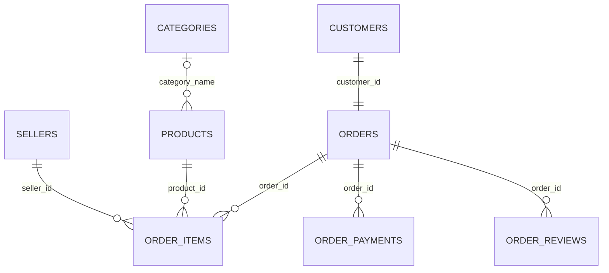

# Архитектура `core` — контракт для команды

Состояние: проект схемы, проверенный по восьми исходным CSV Olist. `raw` не изменён. Загрузка в PostgreSQL и проверки `core` выполняются после работы инженера данных. Дата профилирования: 28.10.2026. Повторить проверку: `python scripts/profile_raw.py` после скачивания CSV штатным скриптом проекта.

Подробное объяснение файлов, полей и реальных строк: [разбор data → raw → core](data_walkthrough.md). Редактируемая схема: [draw.io](core_model.drawio), просмотр: [PNG](core_model.png).

## 1. Что требуют первые пять вопросов

| № | Что и на каком уровне считаем | Нужные поля | Случаи, меняющие ответ |
|---|---|---|---|
| 1 | Число **заказов** и выручка **позиций** по календарным месяцам оформления, сентябрь 2016 — август 2018 | `orders.order_id`, статус, дата оформления; `order_items.price` | Только `delivered`; сумма без доставки; нужен календарь из 24 месяцев, включая ноябрь 2016 без заказов; заказ может иметь несколько позиций |
| 2 | Для продавца: уникальные заказы, число проданных единиц и выручка его позиций | Продавец и цена каждой позиции; статус заказа; город и штат продавца | Один заказ может иметь несколько продавцов; нельзя приписывать продавцу весь чек заказа; доставка не входит в выручку |
| 3 | Средний **чек заказа**, среднее число товарных строк и единиц на заказ | Статус, позиции, `price`, `freight_value`, `product_id`, `seller_id` | Сначала собрать суммы на уровне заказа, потом усреднять; чек включает доставку; одна CSV-позиция соответствует одной единице, одинаковые товары могут занимать несколько позиций. Товарная строка отчёта — группа единиц одного товара от одного продавца в заказе, а не строка хранения в `core`. |
| 4 | Уникальные покупатели, покупатели с ≥2 заказами, доля | `orders.customer_id` → `customers.customer_unique_id` | `customer_id` относится к конкретному оформлению; один человек имеет несколько таких ID; контроль 96 096 / 2 997 / 3,12% получается по всем заказам, включая недоставленные |
| 5 | Выручка и доля по категории товара | Цена позиции, статус, товар, категория и перевод | Пропущенную категорию выделить как «Не указана»; для двух категорий без перевода показать оригинал; сумма по категориям должна совпасть с общей выручкой |

Контрольные суммы из задания сопоставлены с CSV: товарная выручка доставленных заказов **13 221 498,11**, лидер продавцов **226 987,93**, лидер категорий **1 233 131,72**, категорий в результате **74**. Средний чек **159,88** совпадает с суммой цены и доставки на заказ. Команда согласовала использование этих определений.

## 2. Карта `raw`

Пустые значения ниже — пустые поля CSV. Числа строк совпали с раздаточным материалом. Ключи в указанном сочетании проверены: неожиданных дублей нет.

| Источник | Строк | Одна строка / ключ | Связи и наблюдения |
|---|---:|---|---|
| `raw.orders` | 99 441 | Заказ / `order_id` | `customer_id` → customers; 160 пустых дат подтверждения, 1 783 передачи перевозчику, 2 965 вручения. 96 478 заказов `delivered`; у 8 из них нет даты вручения, а у 6 заказов другого статуса дата есть. |
| `raw.order_items` | 112 650 | Одна физическая позиция, то есть одна единица товара / (`order_id`, `order_item_id`) | → orders, products, sellers; максимум 21 позиция на заказ, 9 803 заказа с несколькими позициями; 775 заказов не имеют позиций; 1 278 заказов с несколькими продавцами. Пустых полей нет. |
| `raw.order_payments` | 103 886 | Запись о способе/части оплаты / (`order_id`, `payment_sequential`) | → orders; 2 961 заказ с несколькими записями, максимум 29; у одного заказа платежа нет. Пустых полей нет. `payment_installments` — число частей рассрочки, не множитель суммы. |
| `raw.order_reviews` | 99 224 | Отзыв о заказе / (`review_id`, `order_id`) | → orders; 547 заказов имеют несколько отзывов, максимум 3. Один `review_id` повторяется между заказами: 814 повторений, поэтому он не самостоятельный ключ. Пусты 87 658 заголовков и 58 274 текстов. |
| `raw.products` | 32 951 | Карточка товара / `product_id` | → категории; 610 карточек без категории, названия, описания и числа фото; у 2 нет веса и габаритов. В 13 карточках категория есть, но перевода нет. |
| `raw.sellers` | 3 095 | Продавец / `seller_id` | Используется позициями; пустых полей нет. Индекс почты хранить текстом. |
| `raw.customers` | 99 441 | ID покупателя в оформлении / `customer_id` | Используется заказами; `customer_unique_id` — устойчивый ID человека: 96 096 уникальных значений. Пустых полей нет. |
| `raw.product_category_translation` | 71 | Перевод категории / `product_category_name` | 71 уникальный перевод; категории `pc_gamer` и `portateis_cozinha_e_preparadores_de_alimentos` встречаются у товаров без перевода. |

Проверенные ссылки `orders→customers`, `items→orders/products/sellers`, `payments→orders`, `reviews→orders` не имеют отсутствующих родителей. Для полного повторения профиля данные должны быть скачаны в `data/`; эти CSV остаются вне Git по `.gitignore`.

## 3. Единицы учёта и связи

| Таблица `core` | Ровно одна строка | Первичный ключ | Связь |
|---|---|---|---|
| `customers` | ID покупателя в конкретном оформлении | `customer_id` | 1 к 1 с `orders` в текущей выгрузке; `customer_unique_id` повторяется и используется для учёта людей |
| `orders` | Заказ независимо от того, есть ли позиции/оплата/отзыв | `order_id` | 1 к 1 с `customers`; 1 ко многим с items, payments, reviews |
| `order_items` | Физическая товарная единица/позиция заказа | (`order_id`, `order_item_id`) | многие к 1 с orders, products, sellers |
| `order_payments` | Одна запись оплаты заказа | (`order_id`, `payment_sequential`) | многие к 1 с orders; отсутствие допустимо |
| `order_reviews` | Отзыв по паре ID отзыва и заказа | (`review_id`, `order_id`) | многие к 1 с orders; отсутствие допустимо |
| `products` | Карточка товара | `product_id` | 1 ко многим с items; категория необязательна |
| `sellers` | Продавец | `seller_id` | 1 ко многим с items |
| `categories` | Португальский код категории | `category_name` | 1 ко многим с products; английский перевод может отсутствовать |

Все восемь исходных сущностей сохраняются в `core`: это позволяет отвечать на будущие вопросы о доставке, платежах, отзывах и товарах без возврата к `raw`. При соединении двух позиций и двух платежей получится четыре строки. Поэтому каждый факт агрегируется **до** соединения с другим фактом; суммы заказа не суммируются после соединения с позициями или платежами.

## 4. Словарь показателей

| Показатель | Определение |
|---|---|
| Доставленный заказ | `orders.order_status = 'delivered'`. Статус — критерий для выручки, даже у 8 таких заказов с пустой датой вручения. Сам факт вручения по времени — непустая `delivered_customer_at`; это отдельный показатель. |
| Товарная выручка | `SUM(order_items.price)` только по `delivered`; доставка не входит. Цена одной позиции — цена одной единицы. Никакого умножения на `payment_installments`. |
| Чек заказа | Для доставленного заказа `SUM(price + freight_value)` по его позициям. Средний чек — `AVG` сумм по заказам. Платежи не подставлять вместо сумм позиций: их сумма по доставленным заказам отличается от суммы товаров с доставкой. |
| Число заказов | `COUNT(DISTINCT order_id)` на нужном уровне. Для продавца учитывать только заказы, где есть его позиция. |
| Число единиц и товарных строк | Единицы: `COUNT(*)` строк `order_items`, поскольку одна строка хранения — одна купленная единица. Товарные строки отчёта: число разных пар (`product_id`, `seller_id`) внутри заказа. Например, две позиции одного товара от одного продавца дают 2 единицы и 1 товарную строку. Позиции в `core` не объединять. Для доставленных заказов в текущих CSV средние значения: около 1,142 единицы и 1,039 товарной строки на заказ. |
| Повторный покупатель | Уникальный `customer_unique_id` с двумя и более разными `order_id` среди **всех** заказов; контроль 2 997 из 96 096. Отдельный показатель «повторно получил доставку» потребует фильтра `delivered`. |
| Месяц продаж | Месяц `order_purchase_at` заказа в локальном времени исходника; строить диапазон календарных месяцев и `LEFT JOIN` фактов. Ноябрь 2016 показывать нулём. Не использовать дату вручения для вопросов 1–2. |
| Категория | Перевод, если есть; иначе португальский код; если кода нет — «Не указана». Группировать по `category_name`, а подпись строить отдельно, чтобы одинаковые переводы не сливали разные коды. |
| Отсутствующее значение | Пустое или пробельное поле превращать в `NULL`, не в ноль. Ноль — только результат агрегирования пустого календарного месяца или явно записанный ноль в источнике. |
| Несколько платежей | Сумму оплаты считать отдельно как `SUM(payment_value)` на уровне заказа. Не соединять платежи и позиции построчно ради выручки или чека. |

## 5. Контракт загрузки для инженера данных

Все ID и почтовые префиксы — `text` без изменения значения; даты и время исходника без часового пояса — `timestamp without time zone`, обещанная дата доставки и дата создания отзыва — `date`; деньги — `numeric(12,2)`; порядковые номера и размеры — `integer`/`numeric` по смыслу. Для всех текстовых значений: `NULLIF(btrim(value), '')`; идентификаторы с непустым значением сохранять без изменения регистра. Непустое невалидное число/дата или дубликат ключа должны прерывать загрузку с диагностикой, а не тихо исчезать. Загрузка атомарна и повторяема на чистой схеме `core`. `raw` не обновлять.

| Таблица | Столбцы `core` (тип) | Источник и правило |
|---|---|---|
| `customers` | `customer_id text PK`, `customer_unique_id text NOT NULL`, `zip_code_prefix text`, `city text`, `state text` | `raw.customers`, прямое соответствие `customer_zip_code_prefix`, `customer_city`, `customer_state`. `customer_unique_id` **не уникален** в этой таблице. |
| `orders` | `order_id text PK`, `customer_id text NOT NULL UNIQUE FK`, `order_status text NOT NULL`, `order_purchase_at timestamp NOT NULL`, `order_approved_at timestamp NULL`, `delivered_carrier_at timestamp NULL`, `delivered_customer_at timestamp NULL`, `estimated_delivery_date date NULL` | `raw.orders`; переименовать поля `order_purchase_timestamp`, `order_delivered_carrier_date`, `order_delivered_customer_date`, `order_estimated_delivery_date`; статус не перезаписывать. |
| `order_items` | `order_id text NOT NULL FK`, `order_item_id integer NOT NULL`, `product_id text NOT NULL FK`, `seller_id text NOT NULL FK`, `shipping_limit_at timestamp NOT NULL`, `price numeric(12,2) NOT NULL`, `freight_value numeric(12,2) NOT NULL`, `PK(order_id, order_item_id)` | `raw.order_items`; не группировать одинаковые товары при загрузке; не считать `order_item_id` глобальным ID. |
| `order_payments` | `order_id text NOT NULL FK`, `payment_sequential integer NOT NULL`, `payment_type text NOT NULL`, `payment_installments integer NOT NULL`, `payment_value numeric(12,2) NOT NULL`, `PK(order_id, payment_sequential)` | `raw.order_payments`; сохранить каждую запись, не умножать сумму на рассрочку. |
| `order_reviews` | `review_id text NOT NULL`, `order_id text NOT NULL FK`, `review_score smallint NOT NULL`, `comment_title text NULL`, `comment_message text NULL`, `review_created_on date NOT NULL`, `review_answered_at timestamp NOT NULL`, `PK(review_id, order_id)` | `raw.order_reviews`; `review_creation_date` → date, `review_answer_timestamp` → timestamp; тексты могут отсутствовать. |
| `products` | `product_id text PK`, `category_name text NULL FK`, `name_length integer NULL`, `description_length integer NULL`, `photos_qty integer NULL`, `weight_g numeric(12,2) NULL`, `length_cm numeric(12,2) NULL`, `height_cm numeric(12,2) NULL`, `width_cm numeric(12,2) NULL` | `raw.products`; исправить опечатку только в имени столбца `core`: `product_name_lenght` → `name_length`, `product_description_lenght` → `description_length`. |
| `sellers` | `seller_id text PK`, `zip_code_prefix text`, `city text`, `state text` | `raw.sellers`; почтовый префикс не переводить в число. |
| `categories` | `category_name text PK`, `category_name_english text NULL` | Объединить коды из `raw.product_category_translation` и непустые коды `raw.products`, затем `LEFT JOIN` перевода; так две категории без перевода сохраняются. Не создавать фиктивный ID для неизвестной категории: `products.category_name IS NULL`. |

Внешние ключи `order_items` к заказу/товару/продавцу и `orders` к покупателю обязательны для текущего набора: все ссылки найдены. Даты доставки, платежи и отзывы необязательны как связанные сущности; отсутствие записи не создаёт фиктивную строку. `NULL` в столбцах разрешён только там, где указан `NULL` или не указан `NOT NULL`; PK всегда обязателен. Для `categories` сначала создать справочник, затем products. Порядок загрузки: customers, sellers, categories, products → orders → items/payments/reviews. При появлении новых пропусков в обязательных полях остановить загрузку и пересмотреть контракт, не подменять их фиктивными ссылками.

## 6. Приёмка модели после загрузки

1. Число строк `core` равно числу соответствующих строк `raw` для всех восьми сущностей (для categories: 73 непустых кода из товаров и переводов); PK и FK не нарушены. Отдельно проверить 775 заказов без позиций и один заказ без оплаты — они остаются в `core.orders`.
2. Сравнить суммы `price` и `freight_value` между `raw.order_items` (через явное приведение) и `core.order_items`; отдельно `payment_value` из платежей. Никакой `JOIN` между позициями и платежами в этой проверке не нужен.
3. Аналитик запускает пять запросов **только к `core`**. Контроли: 24 месяца с пустым ноябрём 2016, выручка 13 221 498,11; лидер продавцов 226 987,93; средний чек 159,88; 96 096 покупателей и 3,12% повторных; 74 категории, лидер 1 233 131,72, сумма категорий 13 221 498,11.
4. Проверить расхождения статуса и даты вручения (8 и 6 случаев), категории без перевода (2 кода), несколько отзывов (547 заказов) и несколько продавцов (1 278 заказов). При изменении источника обновить профиль и обсудить правила прежде, чем менять схему.

## 7. Короткая записка для защиты

`raw` оставили неизменным, чтобы повторить загрузку и сравнить результат с источником. Заказ и его товарные единицы разделили: у заказа бывает несколько товаров, продавцов, платежей и отзывов. Ключ позиции — `(order_id, order_item_id)`, платежа — `(order_id, payment_sequential)`, отзыва — `(review_id, order_id)`, поскольку один `review_id` повторяется. Суммы товаров считаем на уровне позиции, чек — сначала на уровне заказа; так связи один ко многим не увеличивают деньги. Пустые даты и категории сохраняем как `NULL`, статус не исправляем по косвенным признакам. Отказались от одной широкой таблицы заказа и от расчёта выручки по платежам: они смешивают уровни и дают другие суммы. Новые источники и вопросы добавляем отдельными фактами или справочниками, сохраняя ключи и сверку с `raw`.

## 8. После новых вопросов

Сначала пробовать ответить из текущего `core`. Если данных не хватает, фиксировать конкретный вопрос и минимальное расширение (новое поле, справочник или факт), затем обновлять контракт и загрузку. После изменения запускать все десять запросов и повторять сверку старых пяти контролей. Историчные атрибуты продавца, товара и категории в будущих выгрузках потребуют периодов действия; текущая выгрузка даёт только один срез справочников.

## 9. Пример на исходных данных

Заказ `32e4fa9bb468884309b58b9348de70c3` в `raw.orders` имеет статус `delivered`, оформлен 04.07.2018 и связан с `customer_id = e54367d4b00c5cb76d2dfe71b9bdb89c`. В `raw.customers` этому ID соответствует `customer_unique_id = 196fbfa6f817924c4e13687eef22fb30`. В `core.orders` будет одна строка заказа, в `core.customers` — одна строка ID оформления; устойчивый ID человека останется в `core.customers`.

В `raw.order_items` для него две строки с `order_item_id = 1` и `2`: один и тот же `product_id = 6d0d7c2d9a4b8b79dbc12c47c74349dd` и `seller_id = 709e16e2b25c7474d980076c6bfc4806`, цена каждой единицы 59,00, доставка каждой 13,07. В `core.order_items` останутся **две** строки. Это 2 единицы и 1 товарная строка отчёта (одна пара товар–продавец). Товарная выручка заказа — 118,00; чек с доставкой — 144,14.

В `raw.order_payments` две записи: карта 124,14 и ваучер 20,00. В `core.order_payments` останутся две строки; их сумма — 144,14. При прямом `JOIN` двух позиций с двумя платежами получится 4 строки: цена товаров ошибочно станет 236,00, а суммы платежей — 288,28. Правильно отдельно собрать позиции и платежи по `order_id`, потом соединить два итога. Один отзыв этого заказа станет одной строкой `core.order_reviews`; его оценка 3 не влияет на выручку.

Другой реальный заказ `002f98c0f7efd42638ed6100ca699b42` содержит товары двух продавцов с ценами 8,99 и 44,90. Выручка заказа — 53,89, но выручка каждого продавца — только его 8,99 или 44,90. Общий чек нельзя приписать обоим продавцам.

## 10. Открытые вопросы и следующие проверки

1. **Товарная строка против единицы.** Принято рабочее определение товарной строки как пары (`product_id`, `seller_id`) внутри заказа. Оно даёт примерно 1,039 строки и 1,142 единицы на доставленный заказ. В задании нет контрольного числа для этих двух средних; аналитик должен подтвердить трактовку перед сдачей.
2. **Статус против даты вручения.** Для выручки используется статус `delivered`. В данных есть 8 таких заказов без даты вручения и 6 заказов других статусов с датой. Для отчёта о сроках доставки отдельно решить, считать ли факт по дате, по статусу или показывать расхождения в качестве данных.
3. **Деньги заказа против платежей.** По доставленным заказам сумма позиций с доставкой равна 15 424 463,65, сумма записей оплаты — 15 422 461,77; разница 2 001,88. Выручка и средний чек сверены с контролями по позициям. Для финансовой сверки нужно исследовать заказы, создающие разницу, не «чинить» её присоединением платежей к позициям.
4. **Фактически полученное количество.** `order_items` показывает заказанные единицы, а статус `delivered` относится к заказу целиком. В отзыве примера покупатель сообщает, что получил одну из двух единиц; отдельного факта вручения каждой позиции в источнике нет. Не называть `COUNT(order_items)` достоверным количеством фактически вручённых единиц.
5. **Приёмка после загрузки.** PostgreSQL и Docker не были запущены при проектировании, поэтому структура и контрольные цифры проверены по CSV, а не по наполненному `core`. После загрузки нужны проверки PK/FK, числа строк, сумм и пяти аналитических запросов. Остальные пять вопросов организаторы выдадут позже.
6. **Число заказов в месячном отчёте.** Рабочее правило контракта — считать delivered. Сам контроль выручки не устанавливает, должно ли число заказов включать все оформления или только доставленные. Это надо отдельно согласовать с аналитиком/организаторами.
